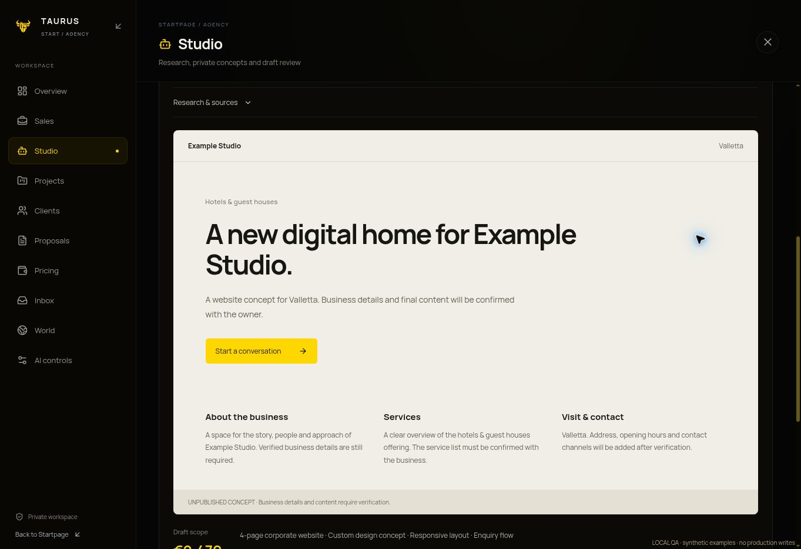
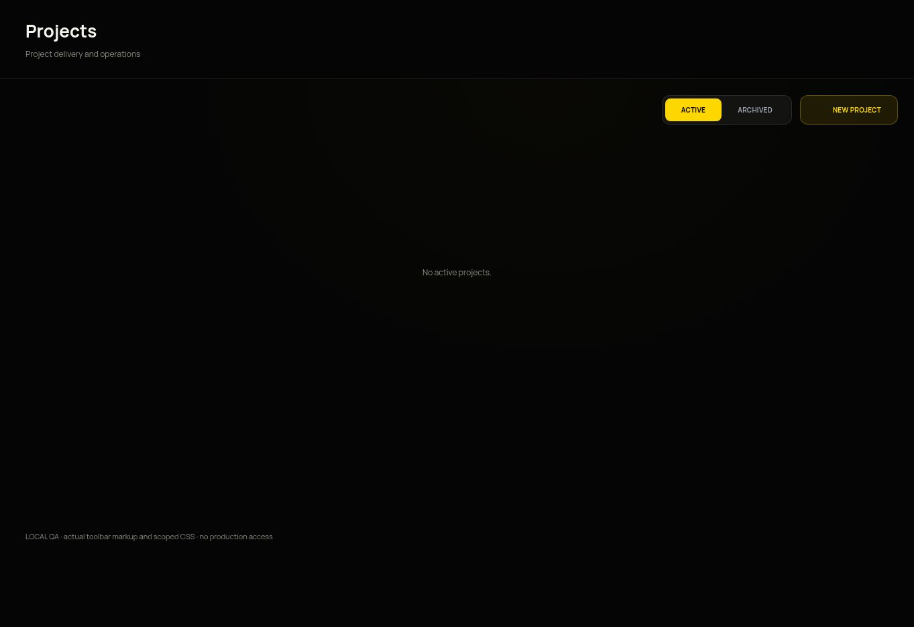

# Agency audit and research runner

The new Continue workflow is described in [agency-continue-workflow.md](agency-continue-workflow.md).
The template/score runner below is retained for earlier concepts; new automation discovery uses AI research checkpoints.

## Requested history removal · 11 November 2026

Finished, failed and cancelled runs can be removed from Run history and restored
with Undo. This retains the underlying run evidence, linked companies, concepts
and attempt counts; it writes only history visibility fields and an audit entry.
Queued/running/paused tasks and pending reviews must be resolved before removal.
Archived runs cannot be restarted by an old browser tab. The new POST action
uses the same admin session, Origin policy and isolated-preview gate.

The user also explicitly requested removal of the one old Sliema hotel search.
`scripts/cleanup-studio-history.js` performs that operation once at the end of a
reviewed Vercel production build using the existing server identity. It does not
run locally, in CI or in previews, and no credentials are copied to the workspace.
It requires exactly one finished discovery run for MT/Sliema/hospitality created
before the discovery correction (11 November, 12:00 UTC); zero/multiple matches
stop cleanup without modifying any run. A persisted receipt prevents repeat
cleanup, including after an operator restores that entry. The production log
reports only the removed run ID and verified visibility result. Remove this
completed migration hook during a future routine maintenance release.

## Baseline audit · 10 November 2026

The production portfolio deployment `f86e3cb` and Startpage `30d8917` were both
READY before work began. Read-only/negative production checks established:

| Boundary | Observed result |
| --- | --- |
| `/admin` and `/admin.html` | 307 to Startpage `/#agency/overview` |
| `/workspace.html` without a session | 302 to Gateway; private, no-store |
| Pricing module and its compiled CSS/JS | 200; Startpage explicitly allowed as a frame ancestor |
| Legacy PDF pricing entry | 200 |
| Pricing API without a session | 401; exact credentialed Startpage CORS |
| Startpage preflight | 204; credentialed exact-origin allowlist |
| Save from an untrusted Origin | 403 |
| Startpage without a session | 307 to existing Gateway |
| Public pricing bundles | No credential-pattern findings |

No customer form, real customer message, notification or authenticated proposal
save was submitted. These checks establish routing/access/asset availability,
not a live authenticated persistence test.

### Findings addressed by this branch

- Three simultaneous font families across shell and embedded modules: the private
  agency UI now uses Manrope consistently, including controls and labels.
- Duplicate section title in embedded modules: the shell owns the only section
  heading. Inner headings are explicitly marked and hidden only in agency embed
  mode; toolbar actions and standalone behavior remain intact.
- Manual prospect/task records had no executor: replaced the placeholder workflow
  with a bounded server-side research and private-concept runner.

## Operational flow

1. Sales → select Malta or Türkiye, a named research area and a business sector.
2. **Find & prepare** durably enqueues an idempotent job, then awaits execution on
   the server. The request continues server-side independently of the rendered
   tab; interrupted/server-timeout jobs are recoverable after their lease expires.
3. Directory research retrieves up to three named independent businesses. Every
   record retains its exact OpenStreetMap source URL. Chain-tagged businesses are
   skipped. The sample is intentionally not presented as complete market coverage.
4. Listed public HTTPS websites receive one bounded HTML structural check. No
   remote JavaScript executes. Missing title/viewport/description/h1/contact
   signals affect a transparent opportunity heuristic; this is not a Lighthouse
   or accessibility audit. Failed inspections score zero, not a negative quality
   claim. Missing directory website fields are explicitly unverified opportunities.
5. At score 70 or above, a private template concept, short brief and four-page
   price estimate are prepared automatically. A manually selected company can
   also receive an explicit concept task regardless of the heuristic.
6. Studio shows source evidence, limitations, English/Maltese-market or Turkish
   concept copy, price estimate and durable run checkpoints. Templates are labeled
   as templates; they are never represented as AI-generated or finished websites.
7. Optional **Refine copy with AI** runs only through the existing verified-free
   Gemini engine. No Google Search grounding, paid search, new credentials or
   paid fallback is used. Public business fields are untrusted data; model output
   is bounded structured text rendered as React text.
8. The operator approves or rejects the exact concept revision. Approval is
   internal only. **Open in Pricing** transfers an approved scope to the existing
   calculator; that module refreshes current pricing and requires its existing
   explicit save. No fictitious customer email or order is created by research.

There is no unattended schedule in this version. Each run is started explicitly
and completes a maximum of three companies in one awaited, 60-second serverless
request. A saved queued/failed task can be run from Studio. This is an executable
first research/design workflow, not an autonomous coding/deployment team.
Public demo sharing, outbound contact, contracts, Git changes and production
publishing remain outside this runner. It never calls messaging or deployment APIs.

## Storage, limits and recovery

- `studio_jobs`: typed `discovery`, `draft`, `copy` jobs, request fingerprint,
  queued/running/review/completed/paused/failed/cancelled state, attempts,
  bounded checkpoints and output prospect IDs.
- `studio_prospects`: deduplicated directory records, research evidence and one
  private concept revision. Existing sales stages and discovery-rerun concepts
  remain intact. Explicit draft/copy tasks create a new review revision.
- `studio_runtime/runner`: transactional single-worker lease, 120 seconds;
  maximum three attempts per job. Cancellation/emergency pause is checked at
  each persisted checkpoint and immediately before final completion.
- `studio_runtime/directory`, `studio_directory_cache`: five new searches per UTC
  day, one-minute global cooldown, 24-hour result cache. The free European
  Overpass instance `ovp.dresel.systems` is tried first, then Private.coffee
  on a transient failure only. The European source updates its data daily.
  A logical search makes at most two sequential requests of 14 seconds each.
  A provider 429 stops the search without changing hosts. An operator-controlled
  HTTPS `STUDIO_DIRECTORY_URL` selects one exclusive compatible instance.
  No client-provided endpoints are accepted.
- `studio_audit`: queue/start/finish/failure and revision-based review receipts.
  No provider secrets are written to these records.

The existing default-deny Firestore rules keep these collections server-only.
The new API actions reuse existing session revocation checks, admin claims, exact
Origin allowlist and isolated-preview gate. No auth, rules or credentials changed.
The public portfolio entry pages do not load any new runner UI/code.

### Discovery failure correction · 10 November 2026

The user’s first Sliema hotel search failed before its first checkpoint. The
previous catch discarded transport details and persisted only `runner_failed`;
production logs therefore cannot establish its exact historical exception.
Read-only reproductions saw HTTP 502 and native `TimeoutError` responses from
the external directory boundary. An independent Node 26 live check also timed
out against Private.coffee and the main Overpass instance. The old mocked tests did not prove that
boundary worked, and this was an unresolved limitation of the first release.

The corrected adapter translates fetch/body-read failures into safe typed
errors, uses one bounded free failover, reduces Overpass query resource requests,
retains caching/quota protections and never fabricates successful results.
Per-provider logs contain only a fixed provider identifier, safe error code,
HTTP status and elapsed time. Runner logs add phase, task reference and a local
module/line reference when available; raw errors, URLs and credentials are not
logged. Jobs retain a readable reason, phase and retry time. Cooldown/quota
blocks make no external request and consume no execution attempt. Real failed
network attempts still count against the three-attempt cap.

Startpage renders the reason and retry availability, disables premature retries,
and labels old generic failures without inventing a historical cause. The new
`scripts/check-studio-directory.js` checks the actual Sliema hospitality flow
using real public directory/site reads, current default pricing and in-memory
persistence. A dedicated PR check runs it on Node 26 without credentials or any
production writes. This external check is separate from deterministic tests;
neither a passing build nor synthetic browser fixtures imply provider uptime.

A live read from the documented free European endpoint returned HTTP 200 and
30 Sliema hotel/guest-house records. Normalization selected Saint Julians Bay
Hotel (`node/301355391`), Alborada Aparthotel (`node/1316077749`) and Valentina
Hotel (`node/1332708982`), each retaining its exact OSM source. No production
records were written by that check. Public source availability remains an
external dependency rather than a guarantee.

On 11 November the full live read → normalization → website check → private
concept/estimate flow completed in 6.3 seconds using isolated in-memory storage:
three real companies, two template concepts awaiting review, one explicitly
unavailable website inspection. An Ankara hospitality read also returned HTTP
200 with 30 directory records, confirming that the European extract covers
the selected Turkish market as well as Malta.

## External source policy

This is a low-volume, private pilot using small OpenStreetMap extracts with visible
[ODbL attribution](https://www.openstreetmap.org/copyright). Public Overpass has
[shared resource limits](https://dev.overpass-api.de/overpass-doc/en/preface/commons.html);
move to a dedicated compatible instance before scaling or scheduling bulk work.
No geocoding/autocomplete or Google Maps scraping is used. Source data does not
establish contact permission. The runner does not collect email/phone fields or
send outreach.

Website inspection permits only HTTPS domains with globally routable IPv4
addresses, pins the checked DNS result to the TLS connection, checks every
redirect, and caps total time/bytes/redirects. IPv6-only, HTTP-only, protected,
large or unavailable sites are skipped with an explicit limitation. These skips
are not treated as evidence that a company needs a new site.

## Validation and release

All 107 backend tests pass, including 18 runner scenarios. The full portfolio
quality build and Startpage production build also pass. Browser QA confirmed
that the Projects toolbar renders exactly one visible Projects heading in
Manrope, and the synthetic Malta research/concept approval closes the run and
unlocks Pricing. Runner tests use an isolated in-memory transactional
store; browser QA uses the real React components and runner with clearly labeled
synthetic directory inputs, without production access. A live provider read returned HTTP 502: Overpass reported full query-worker
capacity. Provider failure is surfaced, not replaced by invented firms. A
single documented alternate public endpoint also timed out. The external
discovery boundary therefore still requires a successful isolated preview run;
mocked pipeline tests do not prove provider availability. Real authenticated production
writes, paid model calls and public deployments are not part of validation.

Keep both changes in draft PRs for review. Publish the backend first and frontend
second only through the existing human-reviewed Git workflow. No direct main
push or manual production deployment is needed for this work.

Browser evidence (local QA, synthetic input):

