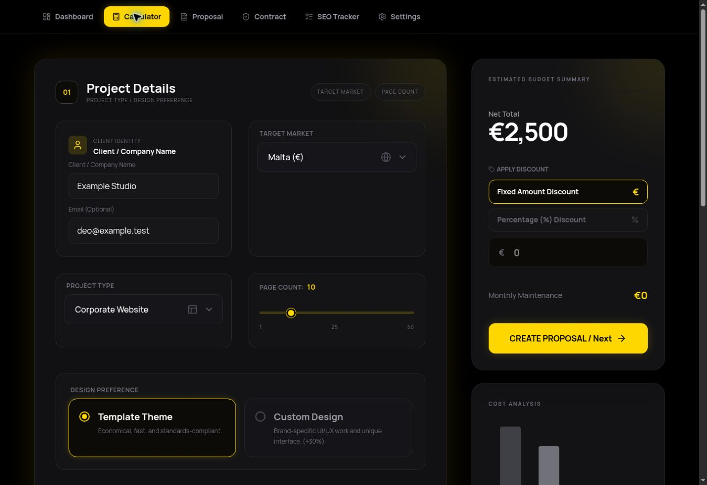

# Startpage agency workspace

The Startpage at `https://start.omeryigitler.com` remains the entry point. Its
Taurus standby, command bar, folders, notes and History workspace are retained.
The Agency module opens `/#agency/overview`; individual sections use the same hash
route. Direct legacy admin visits open this workspace after Gateway verification.

## Integration

The workspace UI is English and shares the Startpage Taurus typography (Manrope, Syncopate and JetBrains Mono), black surfaces and #FFD700 accent. Dropdowns, checkboxes, number fields and confirmation/input dialogs have custom styling and keyboard behavior.

Sales, Studio and AI controls use the existing `/api/agent` function's `studio-*`
actions. They reuse the secure host-only Gateway session cookie. The API checks
revocation and both `admin === true` and `role === 'admin'`, applies an exact
Startpage/portfolio Origin allowlist, and allows credentialed CORS only from the
production Startpage. Cookie-authenticated writes without Origin are rejected.
No provider keys or identity tokens are returned to the browser.

Projects, Clients, Proposals, Inbox and the original world/globe screen
retain their existing admin modules inside a single lazy authenticated iframe.
Only the production Startpage and the same origin are allowed by `frame-ancestors`.
The navigation bridge verifies the referring origin, sender origin and source
window. Its messages contain only readiness and allowlisted view names. It waits
for the admin claim check before signaling readiness. An expired session offers
a top-level Gateway renewal with a return to the selected section.

## Agency records and execution

`studio_prospects`, `studio_jobs`, `studio_audit`, `studio_config`, and bounded
AI accounting collections are server-only under the existing default-deny rules.
Domain deduplication retains the prospect's sales stage. Contacted requires
explicit confirmation of manual contact. Job submission is idempotent and jobs
remain paused until an execution service exists. No research, code generation, deployment, outbound contact, or paid-model execution is automated by this change.

AI controls apply to existing daily chat, classification and Telegram model calls.
Missing or expired verified-free provider configuration blocks external models;
deterministic admin tools keep working. FREE/HYBRID does not activate paid usage.
Settings and API responses never include a provider key. Existing environment
values, Passkeys, Telegram credentials and Firebase rules are unchanged.

Preview Studio access/execution remains blocked unless an isolated backend has
been explicitly configured. Production Startpage is the only cross-origin host;
preview domains are intentionally not added to the trust boundary.

## Validation

- 89 backend/security tests pass, including spoofed navigation, strict admin
  claims, revoked sessions, CORS, free-only accounting and idempotent CRM writes.
- Portfolio `npm run quality` and Startpage production build pass.
- 104 public built files match the current main baseline byte for byte; pricing module output and admin-only integration assets are excluded.
- Credential pattern scans return no findings in either project's frontend.
- The independent Vite pricing module was verified in the managed browser: English calculator, custom market dropdown, price recalculation, proposal preview and custom confirmation dialog. Real authenticated save and device Passkey tests are not claimed. The Next.js shell still cannot run through the managed preview launcher.

Release order: portfolio backend first, then Startpage. One production release per
repository is sufficient; do not redeploy separately after an automatic Git build.

## Independent Pricing module and incoming leads

`/tools/pricing/index.html?plugin=agency` is a self-contained versioned module;
its compiled CSS, shared controls and JavaScript are bundled without a Tailwind
CDN or environment-key injection. `/pricing-tool/dist/` remains a compatibility
path for existing PDF jobs. Both paths explicitly allow the Startpage as a frame
ancestor, fixing the nested SAMEORIGIN failure. The Startpage embeds Pricing
directly, separate from the operations module. Pricing settings and proposal
saves use authenticated `studio-pricing-*` API actions. The server validates
rates and recomputes totals rather than trusting browser-supplied prices.
English interface language is independent of the selected TR/MT market.

The former `/admin` and `/admin.html` addresses redirect at the routing layer to
Startpage. The private compatibility runtime is served through authenticated
`/workspace.html`; it is an internal module, not a second admin navigation UI.

After a valid contact form submission is durably stored, the server prepares a
linked client, project and draft proposal in one idempotent transaction. It
uses the submitted configuration including feature flags and current shared
pricing settings. The workspace does not need to be open. Failed preparation
leaves the message marked pending; opening the operations workspace retries
through the same server service. The browser no longer runs an alternate record
creation pipeline. No proposal is sent, project finalized or contract accepted
automatically. PDFs remain generated on demand from the existing project tools.

Contact-derived names, email addresses and search highlights are escaped at HTML rendering boundaries before being displayed in the operations module.

## Research runner follow-up

The typed, on-demand directory/research/concept runner supersedes the paused-only
planning described above. See [the audit and operational guide](../agency-runner-audit.md)
for its exact capabilities, quotas, approval boundaries and verification limits.
The private workspace now uses one Manrope font family and shell-owned section
headings; the original public homepage typography remains unchanged.
