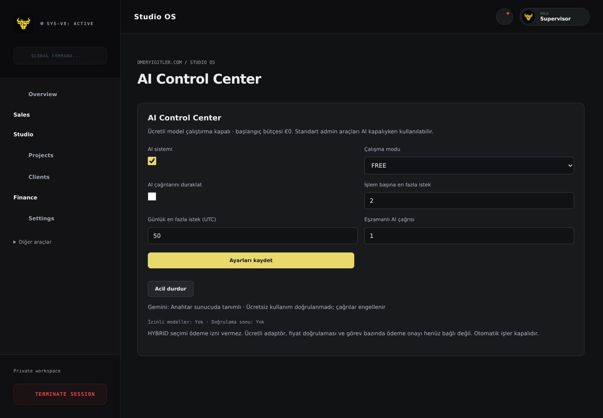
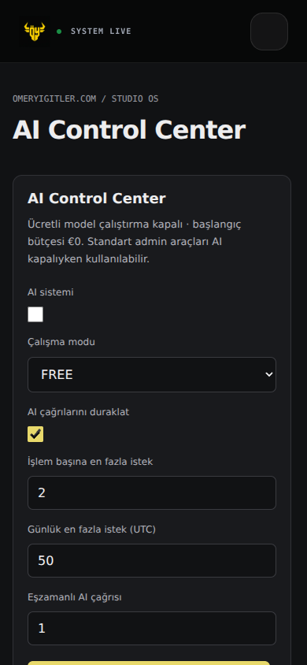

# Studio OS — controlled foundation

Baseline: `37480d9fd84f371e31e021e28235ed0e90079e8a` on `main`.
Branch: `agent/studio-os`. No production deployment, merge, live data write,
provider request, outbound communication or environment mutation was performed.

## Architecture audit

The existing system is static HTML with selected React islands, Vercel APIs,
Firebase Admin and browser Firebase. The admin build concatenates its manifest
into one classic script; global bindings and existing feature modules are retained.
`api/agent.js` already authenticates Firebase/allowlisted Google identities and
uses `lib/agent.js` for proposals with approval, `lib/pricing.js` and
`config/pricing.json` for pricing, and `lib/agent-tasks.js` for daily operations.
The public Tailwind bundle scans admin source too, so even adding utility names
in admin can change the public stylesheet. New UI uses a dedicated stylesheet.

Existing AI calls were found in daily chat and intent classification, with a
hard-coded model fallback chain, plus the Telegram command classifier in
`api/webhook.js`. All three paths now pass through `lib/studio-ai.js`. Models
are chosen only from an explicit server-side verified-free allowlist. Existing
Gemini key presence does not prove a free entitlement. No paid provider is enabled.

Two old open draft PRs (#15 and #58) overlap operational-agent and admin work;
they have not been merged or copied into this branch. Main was reported as
unprotected. Review branch protection separately before enabling code-writing
workers. Vercel deployment protection is enabled for non-custom-domain previews.

Vercel variable metadata shows the same Firebase service-account variable entry
targets production and preview. Its values were not decrypted. New Studio write
and CRM endpoints, and all AI execution, fail closed in Preview unless
`STUDIO_PREVIEW_ISOLATED=true` is explicitly set after isolated Firebase is configured.
Existing legacy admin endpoints are not retroactively isolated by that flag.

## Implemented

- Authenticated AI settings: master switch, pause, emergency stop, FREE/HYBRID
  selection, bounded task/day request limits and distributed concurrency leases.
- Server-side accounting reservations happen before model calls, transactionally.
  Stops are rechecked before fallback attempts. In-flight requests can complete.
  Leases expire after 60 seconds; model calls have a 12-second timeout.
- Bounded fallback only on quota errors and only to configured verified-free models.
  Unknown/expired billing verification blocks calls. Paid credentials are never used.
  Premium mode cannot be activated by a forged settings document or request.
- Per-request model, local request ID, task ID, timestamps, tokens, estimated model
  cost and unknown confirmed cost records. Prompt bodies and secret values are omitted.
  Classification and chat share one task request budget.
- Malta/Türkiye prospect records with sources, research timestamps, location,
  notes, market currency/language and domain-based deduplication. Duplicate saves
  retain pipeline state. Non-website records use normalized name, market and location.
- Sales stage changes and audit history. Contacted requires explicit confirmation
  of manual contact. No message/call sending code is added.
- Role assignment and idempotent task creation tied to a prospect. Jobs are
  explicitly paused with `executor_not_configured`. Cancellation preserves prospects.
- Admin-only restrained styling, ordered primary navigation, secondary legacy
  tools, compact desktop assistant, mobile view, and access to existing pricing,
  proposals, inbox, projects, clients and visitor tools.
- New collections are server-only under the existing default-deny Firestore rule;
  Firebase rules and production records have not been changed.

## Not implemented / do not represent as completed

This is the foundation, not the entire master specification. Paid provider adapters,
verified price catalogs, spend reservations/approvals and non-model cost ingestion
are absent. All three money limits stay at zero; HYBRID is a stored preference,
not permission or a functioning paid integration. The automatic-execution flag is
not exposed as an operational feature; no scheduler or background worker exists.

Company discovery, remote website audits, qualification scores, research caching,
agent tool execution, isolated code worktrees, GitHub PR creation by agents, protected
demo hosting, demo generation, proposal/presentation attachment and prospect-to-client
conversion remain future phases. Existing pricing/PDF features remain accessible;
they are not yet joined to prospect records. Won is a pipeline label only.
Communication eligibility is not a jurisdictional legal validator. Operators must
verify eligibility; no automated outbound action is available. No fake metrics,
demo URLs, agent activity or free-entitlement claims are presented.

CRM/usage/history reads return the newest 50 records, not exhaustive totals.
Provider billing and exact quota balances are unavailable. Audit history is stored
but does not yet have a dedicated inspector. Native controls are used for accessibility.

## Configuration before testing against real services

1. Provision an isolated Firebase project/service account for Preview and set its
   existing FIREBASE_* variables. Only then set `STUDIO_PREVIEW_ISOLATED=true`.
   Do not use this flag to bypass isolation with production credentials.
2. Verify the Google project actually cannot incur model charges for the selected
   account/key/models. A free-tier marketing page or budget alert is insufficient.
   No Google billing access was available during implementation.
3. Set `STUDIO_GEMINI_BILLING=verified_free`, `STUDIO_FREE_MODELS` to a comma-separated
   list of verified eligible model IDs, and `STUDIO_FREE_VERIFIED_UNTIL` to an ISO
   expiry date/time. Keep verification short-lived and recheck after billing changes.
   Missing/expired configuration blocks external AI; deterministic tools continue.
4. Run authenticated integration tests in that isolated environment before merge.

The attestation is an operational control, not independent Google billing telemetry.
Its accuracy depends on the verified provider setup. A provider-side billing change
must invalidate it. Settings may pause new calls; already-running requests are not
guaranteed cancellable. Accounting failures stop additional fallback attempts.

## Security findings and manual actions

- `src/admin/security-settings.js` contained a hardcoded Telegram bot credential,
  automatic Firestore secret persistence and browser-to-Telegram calls. These are
  removed. The settings screen explains server-only configuration. Gateway server
  environment variables are retained; their existing presence was verified by names
  only. No live token was rotated and no legacy Firestore record was deleted.
- The previously exposed token requires provider-side revocation/rotation and a
  controlled server configuration update. Deleting source does not revoke it.
  Review legacy `security_config/telegram` through an authorized migration, then
  remove its secret after continuity verification. Do not print secret values.
- A pattern scan also flagged `elitebody/public/tracker/taurus-tracker.js` and
  `elitebody/services/geminiService.ts`. This separate application is outside this
  admin-only change; review and rotate any still-valid exposed credentials separately.
- Legacy visitor rules allow broad signed-in access. The webhook has optional
  secret enforcement and legacy visitor commands bypass the new Studio queue.
  These existing issues are recorded, not claimed fixed. Changing their behavior
  requires a separate compatibility/security rollout.

## Verification

- Baseline tests: 43 passed. Final full suite: 65 passed (22 new Studio tests).
- Full `npm run quality` passed with the existing dependency lockfiles. This host
  initially failed Chromium archive ownership extraction; a fresh scratch-only
  extraction and `SOCIAL_PREVIEW_CHROMIUM_PATH` resolved it without source changes.
- `node scripts/check-public-baseline.js ../studio-baseline/dist` compares every
  built file except three explicitly admin-only outputs. The homepage, archive,
  shared styles/scripts, assets and all other pages remained byte-identical: 100 files checked.
- Four static screenshot pairs (homepage/archive at 1440px and 390px) were identical.
  JavaScript and external networking were disabled for this comparison; it does not
  establish runtime animation or live-data behavior.
- Mocked browser checks cover settings rendering, emergency stop, form submission,
  legacy-view navigation, and 390px mobile overflow. No Firebase calls or live
  writes occur in those checks. Screenshots below use mocked data.
- Real authentication/data persistence, voice hardware, provider quotas and protected
  demo workflows are not end-to-end verified. Passing local checks is not merge approval.

## File scope

Admin UI: `src/admin/studio-os.js`, manifest/navigation/security settings,
`src/pages/admin.html`, and `public/assets/css/studio-admin.css`.
Server: `lib/studio-policy.js`, `lib/studio-ai.js`, `lib/studio-records.js`,
`api/agent.js`, `lib/agent-tasks.js`, and `api/webhook.js`. The webhook change is
necessary to prevent that existing Gemini entry point bypassing AI policy;
it does not modify public visual code. Tests, baseline comparison and this audit
are development-only. Pricing, public assets, auth verification, domain config,
Firebase rules and build configuration are unchanged.

## Costs

Approved paid-model budget is €0 and paid execution is unavailable. Verified-free
model requests are recorded with a €0 estimate and unknown confirmed cost. Firestore
transactions, Vercel functions/builds/storage, future research/demo services and
human effort can have separate costs; no free hosting guarantee is made.

## Mocked admin previews

